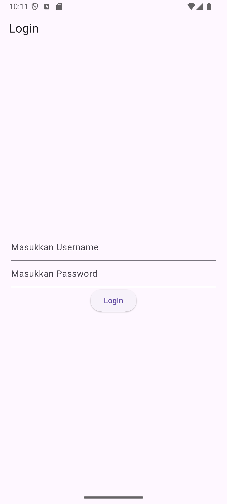
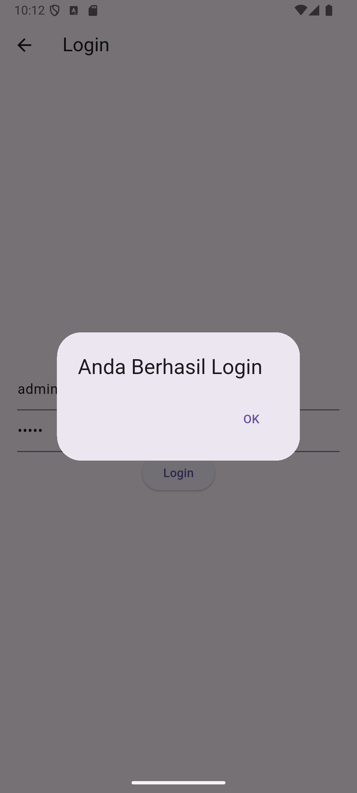
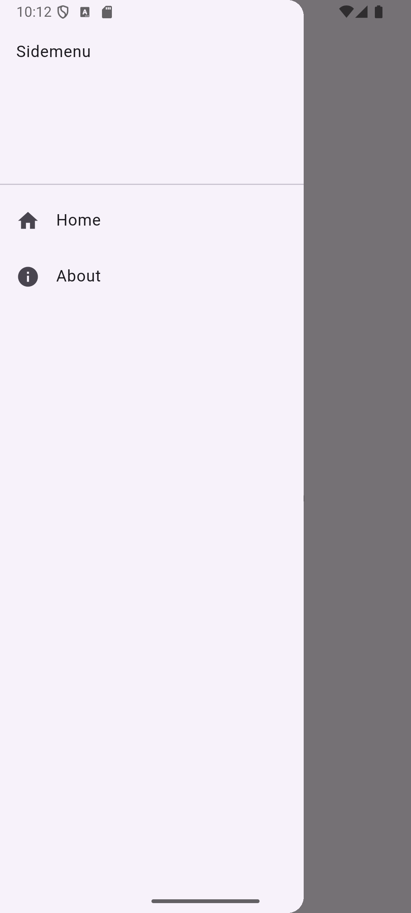

# Praktikum Pemrograman Mobile

**Nama:** Aisyah Nur Sabrina  
**NIM:** H1D024128  
**Shift Awal:** Shift C  
**Shift Baru:** Shift B  

## Dokumentasi

<table>
  <thead>
    <tr>
      <th>Halaman</th>
      <th>Dokumentasi</th>
    </tr>
  </thead>
  <tbody>
    <tr>
      <td>Pertemuan 2</td>
      <td>
        <a href="images/image1.png">
        <a href="images/image2.png">
        <a href="images/image3.png">
        <a href="images/image4.png">
        
      </td>
    </tr>
    <tr>
      <td>Pertemuan 3</td>
      <td>
        
        
        
        
        
      </td>
    </tr>
  </tbody>
</table>

---

## Pertemuan 1 – Pengenalan Flutter

### Deskripsi
Pada pertemuan pertama dilakukan pengenalan framework Flutter serta pembuatan aplikasi sederhana menggunakan bahasa pemrograman Dart.

### Materi yang Dipelajari
1. Pengenalan framework Flutter.
2. Pembuatan project Flutter.
3. Pengenalan StatelessWidget dan StatefulWidget.
4. Penggunaan widget Text.
5. Penggunaan widget Column dan Row.
6. Pembuatan tampilan aplikasi sederhana.

---

## Pertemuan 2 – Desain Framework Flutter

### Deskripsi
Pada pertemuan kedua dilakukan implementasi berbagai widget Flutter untuk membangun tampilan aplikasi, termasuk penggunaan form, detail produk, dan daftar produk.

### Materi yang Dipelajari
1. Penggunaan widget Column.
2. Penggunaan widget Row.
3. Pembuatan Form Produk.
4. Pembuatan halaman Detail Produk.
5. Implementasi ListView untuk menampilkan daftar produk.

---

## Pertemuan 3 – Routes, Side Menu, Login dan Local Storage

### Deskripsi
Pada pertemuan ketiga dilakukan pengembangan aplikasi Flutter dengan menerapkan sistem login, navigasi antarhalaman (routes), side menu menggunakan Drawer, serta penyimpanan data lokal menggunakan SharedPreferences.

### Fitur yang Diimplementasikan

1. **Login Page**

   Halaman login digunakan untuk melakukan autentikasi pengguna menggunakan username dan password.

2. **Home Page**

   Halaman utama yang menampilkan username pengguna setelah berhasil melakukan login.

3. **Local Storage**

   Menggunakan SharedPreferences untuk menyimpan dan mengambil username pengguna secara lokal.

4. **Side Menu**

   Menggunakan widget Drawer sebagai menu navigasi untuk berpindah halaman.

5. **About Page**

   Halaman informasi yang dapat diakses melalui menu About pada side menu.

### Akun Login

- **Username:** admin
- **Password:** admin

### Teknologi yang Digunakan

- Flutter
- Dart
- SharedPreferences
- Material Design
- Android Studio